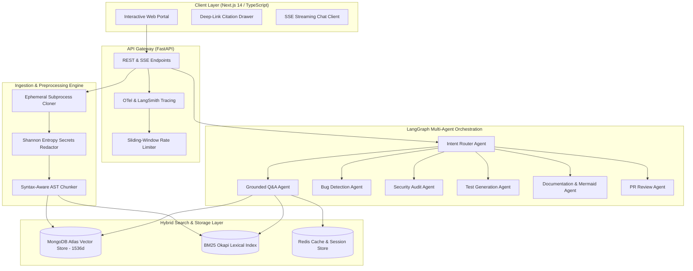

# DevMind — System Architecture & Engineering Specifications

DevMind is an enterprise-grade AI Engineering Copilot designed to understand, navigate, audit, and improve complex software repositories. This document details the underlying engineering architecture, retrieval mechanics, agent state graphs, and security boundaries.

---

## 1. High-Level Architectural Topology

---

## 2. Ingestion & Secrets Sanitization

1. **Ephemeral Sandboxing**:
   - Repositories are cloned into isolated temporary scratch directories with path-traversal safeguards (`os.path.commonpath`).
   - Clone timeouts (120s) and maximum repo size ceilings (500MB) prevent denial-of-service from abnormally large repositories or zip bombs.
2. **Pre-Ingestion Entropy Filter**:
   - Every file undergoes Shannon Information Entropy scanning:
     $$H(X) = -\sum_{i=1}^{n} P(x_i) \log_2 P(x_i)$$
   - High-entropy tokens ($H > 4.5$) combined with regex heuristics detect and mask AWS Access Keys, GitHub PATs, OpenAI secrets, and private keys with `[REDACTED_SECRET]` before vector indexing.

---

## 3. Language-Aware AST Chunking

Traditional RAG tools split code along arbitrary token count windows, severing function signatures from their bodies or breaking classes in half. DevMind implements language-aware Abstract Syntax Tree (AST) parsing:

- **Supported Languages**: Python, TypeScript, JavaScript, Go, Java, and HTML5.
- **Structural Integrity**: Extracts complete semantic nodes (functions, classes, interfaces, schemas).
- **Line Preservation**: Every chunk maintains strict `start_line` and `end_line` metadata, enabling guaranteed citation linking without hallucinated line offsets.

---

## 4. Hybrid Retrieval Pipeline

DevMind combines dense semantic vector embeddings with sparse keyword precision:

$$\text{CombinedScore} = \alpha \cdot \text{DenseScore} + (1 - \alpha) \cdot \text{BM25Score}$$

- **Dense Retriever**: OpenAI `text-embedding-3-small` (1536-dimensional embeddings) indexed in MongoDB Atlas Vector Search using Cosine similarity.
- **Sparse Retriever**: BM25 Okapi keyword frequency engine scoring exact function and variable identifiers.
- **Evaluation Gate**: Verified against benchmark golden datasets achieving Recall@K $\ge 88\%$ and Mean Reciprocal Rank (MRR) $\ge 0.85$.

---

## 5. Multi-Agent Orchestration (LangGraph)

DevMind orchestrates specialized agents using a typed state graph:

1. **Router Agent**: Evaluates user queries and classifies intent into `code_qa`, `security_audit`, `bug_detection`, `test_generation`, `doc_synthesis`, `pr_review`, or `general_greeting`.
2. **Code Q&A Agent**: Grounded exclusively on retrieved AST code chunks with strict citation enforcement.
3. **Security Audit Agent**: Matches source code against OWASP Top 10 vulnerabilities, evaluating CVSS severity and remediations.
4. **Bug Detection Agent**: Correlates static linter diagnostics with semantic reasoning to eliminate false positives.
5. **Human-in-the-Loop Safeguards**: Write operations (such as drafting GitHub PRs or creating branches) trigger conditional graph interrupts requiring explicit human approval tokens.

---

## 6. Container & Security Hardening

- **Non-Root Execution**: Both backend and frontend Docker containers execute under unprivileged UID `10001` (`appuser`).
- **Capability Dropping**: Kubernetes pods explicitly drop all Linux capabilities (`drop: ["ALL"]`) and prohibit privilege escalation (`allowPrivilegeEscalation: false`).
- **Real-Time Streaming**: Server-Sent Events (SSE) stream over HTTP/1.1 and HTTP/2 with disabled proxy buffering (`proxy-buffering: "off"`).
